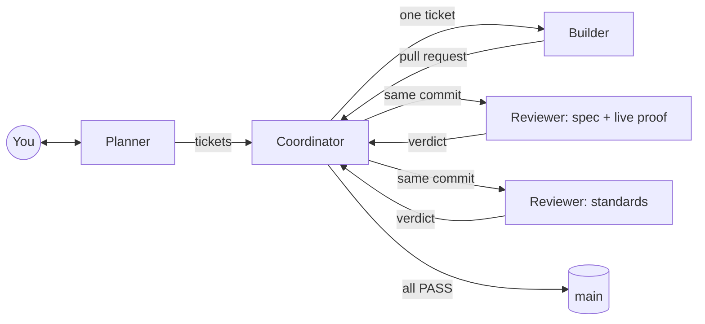

# ai-coding-framework

**For anyone who wants to build software with coding agents and needs to trust what they ship.** It is complete and ready to use: the roles, the rules and the tools are filled in. If you would rather design your own way of working, start from the empty skeleton, [ai-coding-framework-template](https://github.com/nurullah44/ai-coding-framework-template), instead.

Coding agents write code fast. The hard part is knowing the code is right, and keeping the codebase clean as it grows. This framework gives a project a small team of agents with clear jobs, a loop that takes each change from idea to merge with proof at every step, and a habit of turning repeated mistakes into checks.

It is stack-independent: you choose the language and tools with the Planner at the start.

## The six principles

Every rule here serves one of these. The full text, with sources and evidence, is in [`docs/agents/principles.md`](docs/agents/principles.md).

| # | Principle | In one line |
|---|---|---|
| 1 | Proof, not claims | Done means shown working on the running app, with evidence |
| 2 | Enforce, don't instruct | A rule that matters becomes a check that fails |
| 3 | The ticket defines done | Criteria, how each is proven, and which failures are in scope, written before building |
| 4 | Nobody grades their own work | The builder never reviews or merges its own change |
| 5 | Fix it upward | A mistake seen twice becomes a check, so there is no third time |
| 6 | Earn trust before speed | One agent at a time until it is trusted; autonomy and parallel work come after |

## How it works

Four roles, each a separate agent session with one job:

- **Planner** talks the product through with you, then writes the roadmap and the tickets.
- **Builder** takes one ticket to a pull request, with tests and proof.
- **Reviewer** judges the pull request in two independent lanes: does it do what the ticket says on the running app, and does it follow the project's rules.
- **Coordinator** runs the loop: starts Builders and Reviewers, sends failures back, merges, and cleans up recurring mistakes at the end of each roadmap step.

A step-by-step walkthrough of a whole project is in **[`docs/guide.md`](docs/guide.md)**. Start there.

## Quick start

1. Click **Use this template** on GitHub to create your repo, and clone it.
2. Install what the loop uses: [Claude Code](https://claude.com/claude-code), the [Codex CLI](https://github.com/openai/codex), the [GitHub CLI](https://cli.github.com/) (`gh`, logged in), git and Python 3.
3. Delete `sources/` if you don't want it; it is the research behind the framework, not part of your project. Replace this README with your own.
4. Open Claude Code in the repo and say: *"You are the Planner. Read `docs/agents/roles/planner.md` and start Mode 1 with me."*
5. Follow [`docs/guide.md`](docs/guide.md) from there.

Claude Code reads `AGENTS.md` by itself only when there is no `CLAUDE.md`. If you add one (`/init` creates it), make its first line `@AGENTS.md`, or the rules stop loading.

## What is in the repo

| Path | What it is |
|---|---|
| `AGENTS.md` | Always loaded by every agent: commands, hard rules, and where to read more |
| `docs/guide.md` | A project from start to finish, for people new to the framework |
| `docs/agents/principles.md` | The six principles |
| `docs/agents/process.md` | Roles, models, labels and the rules of the loop |
| `docs/agents/roles/` | One file per role: what it does, step by step |
| `docs/agents/templates/` | The ticket and the review verdict |
| `docs/agents/invariants.md` | Rules your code must never break, each with its check. Starts empty |
| `docs/agents/trust-ladder.md` | Where to fix a mistake so it can't come back |
| `docs/agents/garden.md` | The log of mistakes and corrections. Starts empty |
| `.agents/skills/verify/` | The proof tool: a contract, a stub CLI and a feature map. Your project builds the real one |
| `tools/run-role/` | Starts a role as a fresh agent session, with the right model and permissions |
| `sources/` | The research and the test project data this framework is built on |

## Where it comes from

Nothing here is invented. Each part traces to one of these, and was tested on a real project (a URL shortener built by agents, 31 PRs; the data is in [`sources/lessons-from-the-test-project.md`](sources/lessons-from-the-test-project.md)):

- Lauren Tan: [talk](https://youtu.be/Z-jNqqIYGm4), [interview with Matt Pocock](https://www.youtube.com/live/MN9dGgmLyso), [pstack](https://github.com/cursor/plugins/tree/main/pstack)
- Matt Pocock: [skills](https://github.com/mattpocock/skills)
- Alexey Grigorev: [AI-native development: specifications](https://aishippingblog.com/p/ai-native-development-specifications)
- The role-based loop of a product team: PM, engineer, code review, QA

## Status

Version 1, shaped by one test project. Known gaps are listed at the end of the lessons file. It changes when real use shows something worth changing.
