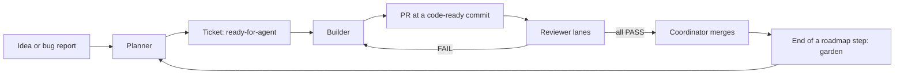

# Process

How work moves from an idea to merged code. New here? Read [`docs/guide.md`](../guide.md) first; it walks through a whole project.

Work lives in GitHub Issues and PRs. Labels carry the state.

## Roles

| Role | Does | Never |
|---|---|---|
| [Planner](roles/planner.md) | Shapes the product with the human, then turns it into a roadmap and tickets | Writes code |
| [Builder](roles/builder.md) | Takes one ticket to a PR that is ready for review | Merges, or changes the ticket's criteria |
| [Reviewer](roles/reviewer.md) | Judges one PR at one commit, in one lane | Fixes code, or reads the Builder's evidence or other verdicts first |
| [Coordinator](roles/coordinator.md) | Starts the other roles, merges, and tends the garden at the end of each roadmap step | Writes product code |

Without a Coordinator, the human plays that part. Every role starts as a fresh session; `tools/run-role` starts them.

## Models

Always pass the model and effort explicitly; never rely on a harness default. These are ours; change the rows to yours. `tools/run-role` reads this table.

| Role | Harness | Model | Effort |
|---|---|---|---|
| Planner | Claude Code | `claude-opus-5-5` | xhigh |
| Builder | Claude Code | `claude-opus-5-5` | medium |
| Builder, third round (after two FAIL rounds) | Claude Code | `claude-opus-5-5` | high |
| Reviewer, every lane | Codex | `gpt-6.1-sol` | xhigh |
| Coordinator | Claude Code | `claude-opus-5-5` | xhigh |

Reviewers run on a different model family from the Builder on purpose: a second opinion from the same model shares its blind spots.

## Ticket size

A ticket fits one fresh Builder session.

- The budget is the Builder's peak context (what the model holds at once), not the total tokens spent.
- Aim for a build to peak under about 150k tokens. In the test project, Opus builds peaked at about 150k and fix rounds stayed under 100k.
- The ticket states its estimate. After the build, the Coordinator writes the measured peak next to it, so estimates can be checked against reality.
- A ticket that will clearly go past the budget is split. If splitting would be wasteful, the Planner says why in the ticket.

## Flow

## Labels

| Label | Meaning |
|---|---|
| `needs-triage` | A report nobody has looked at yet |
| `needs-info` | Waiting on the reporter |
| `ready-for-agent` | Planned and checked; a Builder can take it |
| `blocked-human` | Needs a human: contradictory criteria, a one-way door, a design call, or three FAIL rounds |

## Rules

- **Nobody grades their own work.** The Builder never gives the verdict on its own PR and never merges.
- **A verdict belongs to a commit.** A push that changes the patch voids every verdict and starts a new round.
- **Review rounds.** The first code-ready commit is judged by both lanes: spec + live proof, and standards. After a fix round, one lane judges the new commit: the lane that failed, or spec + live proof when both failed. Both lanes run again when the fix adds behaviour, redesigns, or is large. No merge without PASS from every lane that ran. `UNVERIFIED` is not PASS.
- **Only a blocking finding fails a PR.** [`roles/reviewer.md`](roles/reviewer.md) says what blocks. Everything else is a note, and a note never fails a PR.
- **A fix round fixes findings only.** Work discovered after the PR opened becomes a new ticket.
- **Heavy checks run once.** While building, the Builder runs only the tests for what changed. It runs the full `check` and `verify sweep` once, before it reports a code-ready commit. CI runs `check` on every push.
- **Escalation.** The Builder gets two rounds. The third round runs at higher effort. A third FAIL means `blocked-human`; say whether the rounds failed on the same finding or on new ones, since the human decides differently.
- **One at a time.** One Builder runs at a time, on one ticket (principle 6).

## Autonomy level

Set per project. Start at L0. Move up only with the evidence [`trust-ladder.md`](trust-ladder.md) asks for.

| Level | Merge | Human role |
|---|---|---|
| **L0** | A human merges after the verdicts | Reads every PR |
| **L1** | The Coordinator merges when the merge conditions in `roles/coordinator.md` hold | Reads merged work afterwards, reverts and logs anything wrong |
| **L2** | L1, plus bug reports and alerts open `needs-triage` issues by themselves | Reads samples; tends the garden |

This project: **L0**. One-way doors listed in `AGENTS.md` stay L0 at every level.

## Loops

Run a loop only with a stop condition you can check, such as "no `ready-for-agent` issue is open". A duration or "make it better" is not a stop condition.

## Later: running in parallel

Not part of this version. Lauren Tan and Matt Pocock run several Builders at once, each in its own git worktree, with one owner for rebases and merges. We add it after one-at-a-time runs are trusted, and when the tooling gives each Builder its own checkout and its own `verify` instance.
