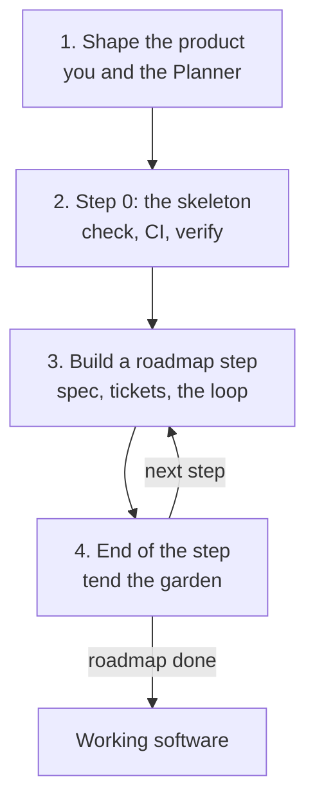
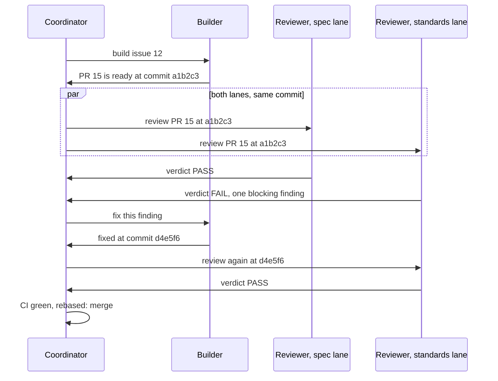
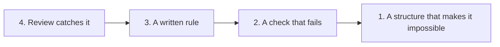

# Guide: a project from start to finish

This guide walks through a whole project built with the framework, from an empty repo to working software. Read it once before you start. The rules themselves live in `docs/agents/`; this page explains how they fit together.

## The big picture

A project moves through four phases. Phase 1 happens once; phases 3 and 4 repeat for every roadmap step.



Who you talk to: in phase 1 you talk with the **Planner**. From phase 2 on, you mostly talk with the **Coordinator**, which starts the Builders and Reviewers for you. Both are ordinary Claude Code sessions that you open in the repo.

## Before you start

You need:

- A GitHub repo created from this template, cloned on your machine.
- [Claude Code](https://claude.com/claude-code) for the Planner, Builder and Coordinator.
- The [Codex CLI](https://github.com/openai/codex) for the Reviewers. Reviewers use a different model family on purpose, so they don't share the Builder's blind spots.
- The [GitHub CLI](https://cli.github.com/), logged in, plus git and Python 3.

The models each role uses are in the Models table of `docs/agents/process.md`. Change them there if you use others.

## Phase 1: shape the product

Open Claude Code in the repo and say: *"You are the Planner. Read `docs/agents/roles/planner.md` and start Mode 1 with me."*

The Planner interviews you. It takes the product one piece at a time, says back what it understood, asks why, pushes back, and tells you how others solve the same problem. It keeps going until nothing is left open. You don't need to arrive with a spec; you need to know what you want the product to do for its users.

Along the way it writes down what you settle:

| File | Holds |
|---|---|
| `GLOSSARY.md` | The words of your domain, so every agent uses them the same way |
| `docs/adr/` | One short record per decision: the stack, the data, security, deploy, the design system |
| `docs/agents/invariants.md` | Rules the code must never break, each with the check that will enforce it |
| `ROADMAP.md` | Numbered steps. Each step is a thin slice of the product plus the capability needed to prove it |

**Example roadmap.** For a URL shortener, step 1 was "create a short link and redirect to it", and the capability it needed first was "`verify` can drive the app over HTTP". Step 2 was "the first dashboard screen", which needed "`verify` can drive a browser". A step starts only when its capability exists.

## Phase 2: step 0, the skeleton

Step 0 builds no product. It builds what every later step needs to prove its work:

1. **`check`**: one command that runs every fast gate (format, lint, typecheck, unit tests). Put it in `AGENTS.md`.
2. **CI** that runs `check` on every push.
3. **The `verify` adapter**: the tool agents use to drive the running app and capture evidence. The framework ships only its contract and a stub (`.agents/skills/verify/`). Your project builds the real one, together with the first piece of behaviour it can drive.

Until `check` and `verify` exist, nothing can pass review. That is deliberate (principle 1).

Step 0 runs through the same loop as every other step (phase 3).

## Phase 3: build a roadmap step

### Spec and tickets

The Planner writes a short spec for the next step only, then splits it into **tickets**: vertical slices, each small enough for one fresh Builder session, each verifiable on its own. Every ticket follows `docs/agents/templates/task.md`:

- **Acceptance criteria**, each with a **Pass when**: the observable result that proves it.
- **Failure modes in scope**: which errors and edge cases this ticket must handle. Anything not listed is out of scope, and a Reviewer reports it as a note instead of failing the PR.
- What is out of scope, constraints, a size estimate, and what blocks it.

Before publishing, the Planner checks every ticket against the project's rules and runs every command the ticket names once. In the test project, about a quarter of the blocking findings traced back to tickets that were wrong, vague, or silent on failure cases.

### The loop

Open Claude Code in the repo and say: *"You are the Coordinator. Read `docs/agents/roles/coordinator.md` and work through the open `ready-for-agent` tickets."* The Coordinator then runs this loop for each ticket, one ticket at a time:



What each part does:

- **The Builder** writes a failing test, then the code that passes it, in small steps. Before it hands over, it runs the full `check` once and proves each "Pass when" with `verify`. It opens a pull request and reports the commit as code-ready.
- **The Reviewers** each start fresh, without the Builder's reasoning or each other's verdicts. The **spec lane** drives the running app and checks every "Pass when" and every in-scope failure mode. The **standards lane** reads the diff against the project's rules.
- **A verdict** is PASS, FAIL or UNVERIFIED, for one commit only. Any new push needs a new verdict.
- **Blocking or note.** Only a blocking finding makes a FAIL: a failed "Pass when", an unhandled in-scope failure, a broken project rule, or a serious defect such as lost data or a security hole. Everything else is a note and never fails a PR.
- **Fix rounds** fix the blocking findings only. After a small fix, only the lane that failed reviews again.
- **The Coordinator merges** when every lane that ran is PASS on the same commit and CI is green.

The commands the Coordinator uses (you can run them yourself too):

```
tools/run-role/run-role builder 12                     # build issue #12
tools/run-role/run-role reviewer 15 --lane spec        # spec + live proof on PR #15
tools/run-role/run-role reviewer 15 --lane standards   # standards on PR #15
tools/run-role/run-role builder 12 --pr 15             # a fix round on PR #15
```

Each run is a fresh session with the model from the Models table and only the permissions its role needs. Its output and measurements are kept under `.verify/runs/`.

## Phase 4: end of the step, tend the garden

Every correction and workaround during the step was logged in `docs/agents/garden.md`, one row per root cause, with a count of how often it was seen. When the step's last ticket merges, the Coordinator reads the garden:

- **Seen twice or more:** move it up the [trust ladder](agents/trust-ladder.md) now. Usually that means a new check, so the mistake fails automatically next time.
- **Seen once and unlikely to return:** close it with the reason.



This is how the project gets more trustworthy over time: the same mistake should never cost a review round three times.

## Who does what

| Artifact | Written by | Used by |
|---|---|---|
| `GLOSSARY.md`, ADRs, `ROADMAP.md` | Planner, with you | Everyone |
| `invariants.md` | Planner; the Coordinator adds checks from the garden | Builder, standards Reviewer |
| Ticket (GitHub issue) | Planner | Builder, both Reviewers |
| Code, tests, `verify` extensions | Builder | Reviewers |
| Pull request | Builder | Reviewers, Coordinator |
| Verdict (PR comment) | Reviewer | Coordinator, Builder |
| `garden.md` | Anyone who corrects or works around something | Coordinator, at the end of each step |
| Merge | Coordinator, or you at L0 | |

## When something goes wrong

- **A ticket contradicts itself or the code.** The Builder stops and labels the issue `blocked-human`. You or the Planner fix the ticket.
- **Three FAIL rounds on one ticket.** The loop is not converging, so it stops with `blocked-human`. Check whether the rounds failed on the same finding (the Builder is stuck) or on new ones (the ticket is too vague).
- **UNVERIFIED.** The proof could not run, usually because `verify` can't drive something yet. It never counts as a pass; extend `verify`.
- **A change touches a one-way door** (paths you list in `AGENTS.md`, such as migrations or anything that deletes user data). It always waits for your approval.

## How much to trust the loop

Start at **L0**: the Coordinator prepares everything and you merge after reading each PR. Move to **L1**, where the Coordinator merges and you read merged work afterwards, once verification covers what the work touches and the garden shows no recurring review catches. The levels are in `docs/agents/process.md`.

Run one Builder at a time. Running several in parallel comes later, once one at a time is trusted (principle 6).

## Words used in this framework

| Word | Meaning |
|---|---|
| Ticket | A GitHub issue written with the task template; one Builder session's worth of work |
| Pass when | The observable result that proves one acceptance criterion |
| Failure modes in scope | The errors and edge cases a ticket must handle; the rest are notes |
| Code-ready commit | The commit a Builder hands over for review |
| Lane | One Reviewer session with one focus: spec + live proof, or standards |
| Verdict | A Reviewer's result for one commit: PASS, FAIL or UNVERIFIED |
| Blocking finding / note | A problem that fails the PR / a remark that never does |
| Round | One review of one commit; a fix push starts the next round |
| `check` | The one command that runs every fast gate |
| `verify` | The tool that drives the running app and captures evidence |
| Feature map | `.agents/skills/verify/features/`: what the app does and how to drive each part |
| Garden | The log of mistakes and corrections, one row per root cause |
| Rung | A level of the trust ladder: codebase, checks, guidance, review |
| One-way door | A change that is hard to undo; it always needs a human |
